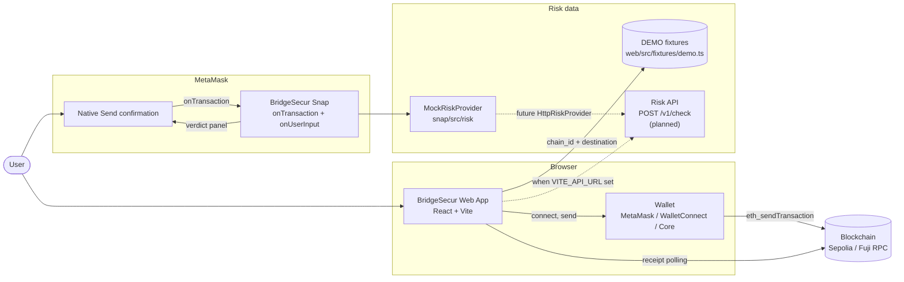
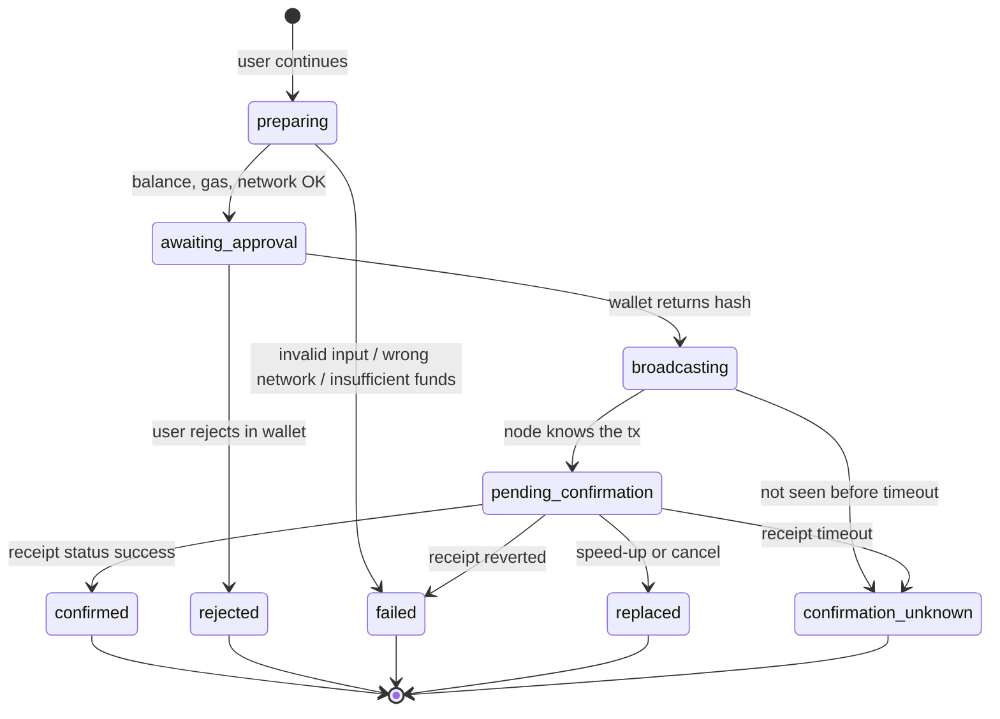
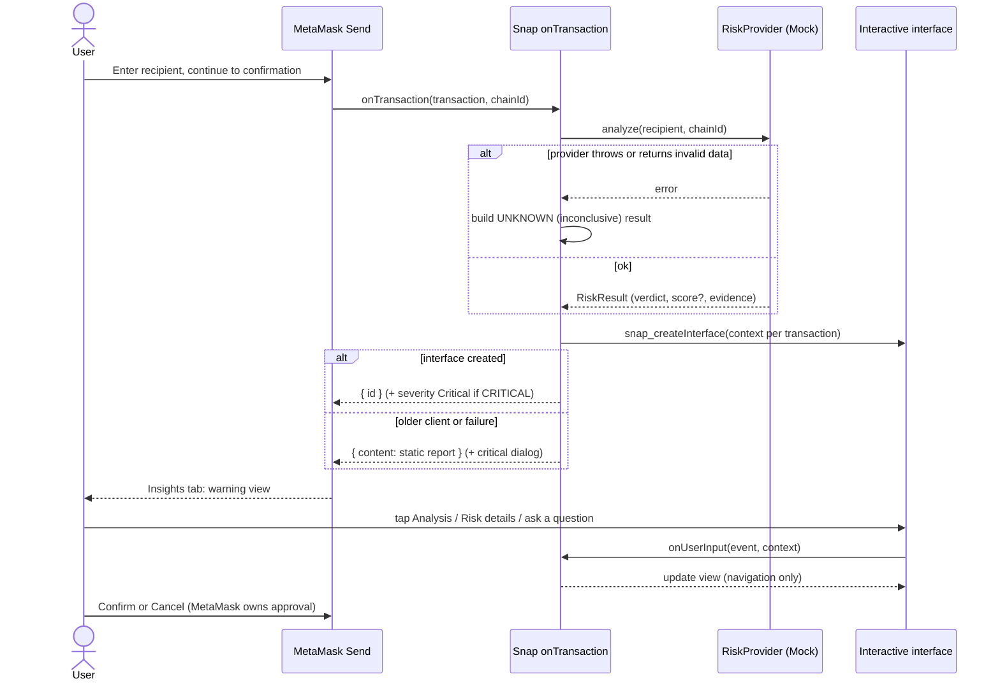
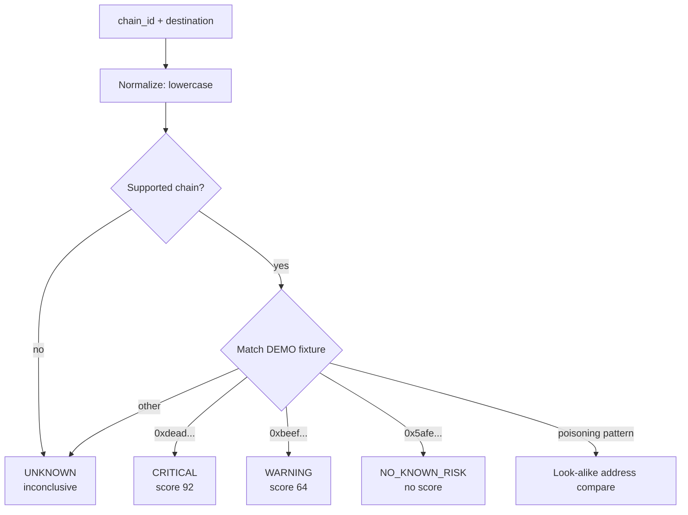

<p align="center">
  
</p>

# BridgeSecur

**Check before you send.** BridgeSecur is a warn-only Web3 transfer safety checker. Before a user sends crypto, it checks the destination address, shows a plain-language verdict with evidence, and lets the user decide. It also ships as a MetaMask Snap that shows the same verdict inside MetaMask's native Send confirmation.

Built for U-Hackathon 2026. Live demo (DEMO risk data, WalletConnect not configured): <https://bridgesecur.vercel.app>

> **Status: UI-first MVP.** All risk data is deterministic **DEMO fixtures**, labelled DEMO everywhere. There is no live sanctions, fraud, or on-chain analysis yet. The product is not a security guarantee and never calls an address "safe" (the best verdict is `NO_KNOWN_RISK`).

Last updated: 2026-10-26.

---

## Problem

Crypto transfers are irreversible. Users lose funds to address poisoning (look-alike addresses), sanctioned or scam recipients, and wrong-network sends. Wallets show a raw hex string and a Confirm button, with no context at the moment of decision.

## Principles

| Principle | What it means in code |
|---|---|
| Warn-only | Never blocks a send, never holds funds. The user can always continue. |
| Non-custodial | Never asks for keys or seed phrases. The wallet signs, MetaMask or the connected wallet owns approval. |
| Honest verdicts | Four verdicts only: `CRITICAL`, `WARNING`, `UNKNOWN`, `NO_KNOWN_RISK`. No "safe" label. `UNKNOWN` is shown as inconclusive. |
| Privacy | Only `chain_id` and `destination` are sent for a check. localStorage keeps only theme and language. An e2e test asserts the destination never reaches storage. |
| No fabricated numbers | No USD values (no price source). Gas fee is estimated from the chain or shown as unavailable. |

---

## Repository layout

```
U-hack/
├── web/                          React web app (12 screens, EN/TH)
├── packages/bridgesecur-snap/    MetaMask Snap (transaction insight)
├── docs/
│   ├── architecture/datasets.md  Dataset notes
│   └── progress/                 Session-by-session work log
├── pic/                          Design references
└── *.pdf / *.docx / *.xlsx       Hackathon brief, guides, design PDF
```

Each package has its own README with commands and limitations:
[`web/README.md`](web/README.md) · [`packages/bridgesecur-snap/README.md`](packages/bridgesecur-snap/README.md)

---

## Tech stack

### Web app (`web/`)

| Layer | Choice |
|---|---|
| Framework | React 18.3, TypeScript 5.9 (strict), Vite 7 |
| Routing | React Router 7 |
| Styling | Tailwind CSS 4, Radix UI primitives, class-variance-authority, tailwind-merge |
| Motion | Framer Motion 12, Sonner toasts, lucide-react icons |
| Wallet | Reown AppKit 1.8 + wagmi 2 + viem 2 (injected wallets, WalletConnect) |
| Data / state | TanStack Query 5, in-memory session context, zod schemas |
| i18n | i18next + react-i18next (English, Thai) |
| Chains | Ethereum, Avalanche (mainnets are check-only); Sepolia and Fuji testnets can send |
| Unit / component tests | Vitest 5, Testing Library, jsdom |
| E2E / accessibility | Playwright (local Chrome, mocked wallet and RPC), axe-core, six viewport sizes |
| Quality | ESLint 9, typescript-eslint, `tsc -b` strict |

### MetaMask Snap (`packages/bridgesecur-snap/`)

| Layer | Choice |
|---|---|
| Runtime | MetaMask Snaps, platform 12.1.0, `@metamask/snaps-sdk` 12.1.0 |
| Tooling | `@metamask/snaps-cli` 8.4.1 (`mm-snap build / serve`) |
| UI | Snap JSX components (`Banner`, `Row`, `Section`, SVG images), interactive interfaces |
| Permissions | `endowment:transaction-insight`, `snap_dialog` (no network access) |
| Language / tests | TypeScript 5.9, Vitest 5, plus a bundle smoke test that evaluates the built bundle in an isolated VM |

### Planned backend contract

The web app speaks to `POST /v1/check` (zod-validated response, 10 s timeout, one retry, abortable) when `VITE_API_URL` is set. Without it, the app uses DEMO fixtures. The backend service is not part of this repository yet.

---

## System architecture



The web app and the Snap are independent. The website's check and send flow does not need the Snap. Installing the Snap does not open the website's risk popup. Both read the same verdict model, from separate fixture sets.

---

## Flow 1: Web app transfer flow


Notes:
- The check is invalidated when the destination or chain changes, and stale responses are discarded (`src/state/session.tsx`).
- Acknowledgements are tracked per check, not globally.
- BridgeConsult has no LLM. It composes answers from the check's evidence and labels each as fact, general guidance, or cannot verify.
- History is in-memory and clears on refresh.

## Flow 2: Transaction lifecycle (state machine)

Implemented in `web/src/lib/txMachine.ts`. A state is entered only after the previous operation succeeded. Confirmation requires a successful receipt, never just a broadcast.



Timeouts: prepare 20 s, broadcast 30 s (poll every 2 s), receipt 180 s. Duplicate submissions are guarded in `useTransfer`.

## Flow 3: MetaMask Snap flow



Snap views: **Warning** (verdict first), **Analysis** (bounded templated Q&A), **Risk details** (provider-score SVG gauge). Each confirmation keeps its own JSON context, so there is no global selected transaction. Snap navigation never approves or cancels a transaction. If the provider fails, the result is `UNKNOWN`, so MetaMask never shows an empty insight because of a Snap error.

## Flow 4: Risk verdict decision



---

## Quick start

### Web app

```bash
cd web
npm install
cp .env.example .env     # set VITE_REOWN_PROJECT_ID (https://cloud.reown.com); VITE_API_URL optional
npm run dev              # http://localhost:5173
```

### Snap

```bash
cd packages/bridgesecur-snap
npm install
npm run build
npm run serve            # http://localhost:8080 (leave running)
```

Then open the web app, go to **Settings**, and click **Install BridgeSecur Snap**. Stable MetaMask may refuse local Snaps; use MetaMask Flask. The Snap id defaults to `local:http://localhost:8080` and can be changed with `VITE_BRIDGESECUR_SNAP_ID`.

### Tests

```bash
# web
npm run typecheck && npm run lint && npm run test && npm run build && npm run test:e2e
# snap
npm run typecheck && npm test
```

### DEMO addresses

| Verdict | Snap address | Score |
|---|---|---|
| CRITICAL | `0xdead000000000000000000000000000000000001` | 92 |
| WARNING | `0xbeef000000000000000000000000000000000002` | 64 |
| NO_KNOWN_RISK | `0x5afe000000000000000000000000000000000003` | none |
| UNKNOWN | any other address or unsupported chain | none |

Web DEMO endings: addresses ending `dead` give CRITICAL, `beef` WARNING, `0000` UNKNOWN, anything else NO_KNOWN_RISK. Address poisoning demo: `0x1a2b000000000000000000000000000000003c4d`.

---

## What is real vs DEMO

| Feature | Status |
|---|---|
| Risk verdicts | DEMO fixtures. Not live evidence. |
| Wallet connect | Injected wallets via wagmi; WalletConnect needs a Reown project id. Not verified with a real wallet. |
| Testnet send (Sepolia, Fuji) | Implemented with receipt monitoring. Verified only with mocked wallet and RPC. |
| Mainnet | Check-only. |
| BridgeConsult | Templated answers from evidence. No LLM. |
| Snap in real MetaMask | Unit tests, SDK JSX validation and a bundle smoke test pass. Visual check in a live MetaMask/Flask session has not been performed. |

## Known limitations

- Real-wallet and real-testnet transfers are unverified. Screenshots under `web/screenshots/nkr/` use mocked wallet and receipts.
- Main JS chunk is about 2 MB (AppKit), not code-split yet.
- Snap cannot reuse the website's bottom-sheet CSS; MetaMask controls the native layout.
- Snap `snap.manifest.json` shasum changes with every bundle build. Publishing to npm needs the owner's explicit approval.
- Failed-API e2e is not covered (the client's timeout, network, schema and retry paths are unit tested).

## Roadmap

1. `HttpRiskProvider` for the Snap (needs `endowment:network-access`) and a real `/v1/check` backend.
2. Real data sources: sanctions lists, scam-address feeds, on-chain heuristics, address-poisoning detection from the user's own history.
3. Signature insights (`onSignature`) in the Snap.
4. Real-wallet testnet verification and live Flask visual check.
5. Code-split the web bundle.

## Compliance notes

Designed with Thai PDPA in mind: minimal data sent (chain id and destination only), no persistence of addresses, no account or key collection. Any future backend must add a retention policy, audit log, and legal review before handling real risk data.

## Education & achievements

**Learn. Build. Go further.**

Builder: Nattakamon Jaimetha. Source: [portfolio](https://nattakamon-portfolio.vercel.app/).

**Education**

- King Mongkut's Institute of Technology Ladkrabang (KMITL), B.Sc. Data Science & Business Analytics, Data Engineering track (started 2022).
- Coursework: big data systems, data pipelines, applied machine learning, cloud infrastructure, SQL databases, IT project management.
- Senior project: Document Intelligence, an OCR project (academic, 2025).

**Achievements**

| Year | Event | Result |
|---|---|---|
| 2026 | U-Hackathon 2026 | BridgeSecur, a warn-only Web3 transfer safety checker with a MetaMask Snap (this repository). Participant; no result announced. |
| 2026 | SKY Innovation Spark 2026 (SKY ICT hackathon) | One TrustX, an airport decision-support MVP. Selected among 15 teams; advanced to the round of 5 finalists. Final awards not yet decided. |
| 2026 | Super AI Engineer Season 6 (AIEAT Thailand) | FahMai, a Thai-language retrieval project. Benchmark: 95/100 questions across a 118-document knowledge base. |
| 2025 | Super AI Engineer Season 5 (AIEAT Thailand) | Honorable Mention, Healthcare AI project (เฒ่าทัน). |
| 2019 | National Arts & Crafts Competition | Gold Medal, motion infographic "Preserving Thai Seas". |

## Skills & capabilities

Technologies used across my projects. The stack used in this repository is in [Tech stack](#tech-stack). Source: [portfolio](https://nattakamon-portfolio.vercel.app/). Governance frameworks listed are project research, not professional certifications.

**Generative AI & Agents**

<p>


</p>

**Machine Learning & Vision**

<p>


</p>

**Backend & APIs**

<p>


</p>

**Frontend & Interfaces**

<p>


</p>

**Data & Analytics**

<p>


</p>

**Cloud & DevOps**

<p>


</p>

**Testing & Evaluation**

<p>


</p>

**AI Governance & Safety**

<p>


</p>

## Documentation

Session-by-session decisions and verification notes live in [`docs/progress/`](docs/progress/).
